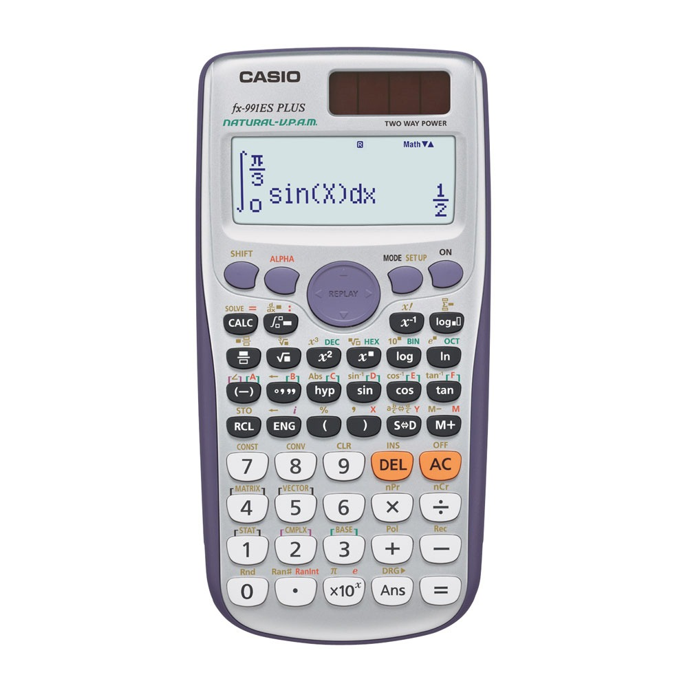

# CASIO fx-991ES PLUS — Natural V.P.A.M. Scientific Calculator

A desktop scientific calculator modeled directly after the **CASIO fx-991ES PLUS (Natural-V.P.A.M. / Two Way Power)**, featuring a realistic handheld body, authentic dot-matrix LCD screen, exact secondary function key markings (SHIFT in gold, ALPHA in red, BASE in green), exact fraction conversion (`S<=>D`), numerical integration (`∫ dx`), numerical differentiation (`d/dx`), and multi-layer math engine.



## Key Features & Highlights

- **Authentic Physical Appearance**:
  - Detailed casing geometry with rounded curves and deep bezel.
  - Metallic silver faceplate with authentic branding (`CASIO`, `fx-991ES PLUS`, `NATURAL-V.P.A.M.`).
  - Realistic solar cell panel with reflection sheen and `TWO WAY POWER` subtitle.
- **Natural-V.P.A.M. Dot-Matrix LCD**:
  - Classic greenish-gray LCD tint with pixel text styling.
  - Live status indicators: `[S]` (Shift), `[A]` (Alpha), `[M]` (Memory), `[D]` (Degrees) / `[R]` (Radians), `[Math]`, and `[▲▼]` (History scroll).
  - Two-line display: Expression editing line with cursor, and high-precision result display.
- **Natural Textbook Mathematics**:
  - Numerical integration (`∫(expr, a, b)`) via Simpson's rule. Example: `∫(sin(X), 0, π/3) = 1/2`.
  - Numerical differentiation (`d/dx(expr, x0)`) via central differences.
  - Summation (`Σ(expr, a, b)`).
  - `S<=>D` Key: Seamless toggling between natural exact forms (`1/2`, `3/4`, `π/3`, `√2`, `2√3`) and standard decimal formats (`0.5`, `0.75`, `1.4142...`).
  - Combinatorics (`nPr`, `nCr`, `!`), Polar/Rectangular (`Pol`, `Rec`).
  - Trigonometric, hyperbolic, logarithmic, and power functions.
- **Replay & History**:
  - 4-way circular `REPLAY` D-Pad: `▲` / `▼` to scroll history, `◀` / `▶` to move the cursor.
- **Secondary Function Labels**:
  - Printed on the faceplate above every button: **Gold** for `SHIFT` functions, **Red** for `ALPHA` variables, and **Green** for base operations.

## How to Run (Windows)

Simply double-click **`run.bat`** in the project folder, or run in PowerShell:

```powershell
./run.ps1
```

Or via Maven:

```powershell
mvn javafx:run
```

## License

MIT. See LICENSE.
